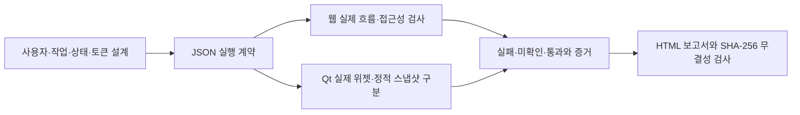
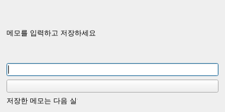
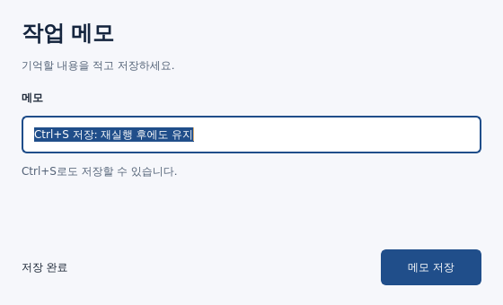

# replica-suite 0.4.0 UI·UX 작업대 검수

2026-11-02, Linux x64에서 관측한 결과다. 이 보고서의 통과는 아래 명시한 범위를 뜻한다. 미적 품질의 우열·원제품 동등성·Windows/macOS 전체 실행을 인증하지 않는다.

## 추가 구현

기존 플러그인에 `uiux-workbench`를 추가해 42개 스킬로 통합했다. 별도 플러그인으로 분리하지 않았다.

계약 생성·검증, 8종 웹 동작과 3종 대상 지정, viewport×flow 격리, WCAG 2/2.1 자동 접근성 검사, 런타임·가로 넘침, Qt 부모 경계·텍스트·아이콘 버튼 접근 이름, 정적 snapshot의 미확인 판정, 증거/보고서/manifest 생성과 변경 검출을 구현했다.

## 실행 검수

| 항목 | 관측 결과 | 의미 |
|---|---|---|
| 플러그인 메타데이터·문법·출처·링크 | 42개 스킬, 오류 0 | 설치 포맷과 공유 리소스의 구조 |
| Python 전체 회귀 | 96개 중 88 통과, 실제 Qt 8개 명시 skip | PySide6 없는 플러그인 venv의 결과 |
| 실제 Qt 별도 검사 | 19/19 통과 | PySide6 6.12.0, Linux offscreen; 위 행의 11개 순수 검사와 중복 |
| Node 계약·증거·프록시 단위검사 | 28/28 통과 | 입력·집계·무결성·경로·HTML 처리 |
| 기존 브라우저 E2E | 3개 suite 통과 | 시각 비교·offline runtime mirror·공유 브라우저 |
| 새 웹 어댑터 | 15개 검증군 통과 | 실제 Chromium 141.0.7390.37, axe-core 4.14.0 |
| 기대 오류·native dialog·긴 로그 회귀 | 5개 검증군 통과 | 실제 브라우저, 기대값 누락·초과·접두사 오인 방지 |
| 새 CLI 통합 | 9개 검증군 통과 | 종료값·잘못된 입력·원본 보존·보고서·프로세스 정리 |
| HTML 보고서 | 3종 렌더, 자동 접근성 위반/미확인 0 | HTML 주입 불실행·파일 링크도 확인 |
| Codex 0.163.0 | 설치·탐색 42개 통과 | 격리 설정; 모델 생성 품질 검사는 아님 |
| Claude Code 2.1.292 | 설치·탐색 42개 통과 | 격리 설정; 모델 생성 품질 검사는 아님 |
| GJC 0.19.2 | 설치·탐색 42개 통과 | 격리 설정; 모델 생성 품질 검사는 아님 |

최종 집계는 [최종 검증 JSON](final-validation.json), [검수한 코드 해시](final-source-manifest.json), [수정 후 실행 요약](final-verification-summary.json), [최종 Python 원문](final-python.log), [최종 클라이언트 원문](final-clients.log)에 기록했다.

전체 명령은 [check 요약](check-summary.json), [check 원문](check.log), [브라우저 요약](browser-e2e-summary.json), [브라우저 원문](browser-e2e.log), [클라이언트 결과](client-verification.json)에 남겼다. Python과 Qt 실행 환경을 분리했으므로 중복 검사를 더해 하나의 통과율로 계산하지 않는다.

동시 실행 당시 호스트 부하로 기존 이미지 검사 startup 30초와 새 브라우저 검사가 시간 초과됐다. 실패 원본은 로컬 검수 캐시에 보존했다. 실제 통과 조건은 유지하고 합성 E2E의 양성 동작 대기만 1.5초에서 10초로 넓힌 후, 전체 `npm run check`(11.263초)와 `npm run test:e2e`(58.488초)를 순차 재실행해 통과했다. 제품 기본 대기는 15초이며 시간 초과는 여전히 미확인/실패로 보고한다.

## 고의 결함과 수정 검증

- 웹: 이름 없는 버튼과 낮은 대비를 검출했다. 저장·재로드, Enter/Escape 모달, test_id/role/selector, 실패 뒤 후속 flow 실행을 확인했다.
- 네트워크: 일반 `route.continue`의 redirect 목적지 우회를 합성 서버에서 재현했다. 자동 redirect 추적 없는 fetch와 3xx 차단으로 수정해 외부 HTTP·WebSocket·redirect 목적지 실제 요청 0건을 확인했다.
- Qt: 텍스트 잘림·부모 영역 이탈·아이콘 버튼 접근 이름 누락 3종을 검출했고 교정 상태의 위반 0건을 확인했다. 정상 스크롤·줄바꿈·기본 QLabel font leading도 검사했다.
- CLI: 잘못된 origin과 Qt 구조 오류에서 출력 디렉토리가 생기던 문제를 사전 검증/임시 결과 처리로 수정했다. 입력 오류 2, 결함 1, 미확인 3, 통과 0을 구분했다.
- 증거: PNG 변조·누락·미등록 파일·경로 이탈·symlink·판정 불일치를 거부했다. 무결성 통과와 검수 통과를 구분한다.
- 정리: Linux에서 관측한 CLI 소유 프로세스 36개 중 종료 후 실행 중인 프로세스 0개였다. 다른 세션의 프로세스를 종료하지 않았다.

## 직접 확인할 합성 산출물

[예제 보고서 HTML](sample-audit/report.html), [실행 결과 JSON](sample-audit/result.json), [실행 계약](sample-audit/contract.json), [manifest](sample-audit/manifest.json), [보고서 화면](보고서미리보기.png).

예제는 실제 사용자 정보가 없는 합성 앱이며 2개 viewport에서 62개 검사 결과가 pass다. 이 62개는 위 E2E 검증군 개수와 다른 단위다. `node scripts/uiux.mjs verify --bundle reports/uiux-0.4.0/sample-audit`로 파일 19개의 무결성을 다시 확인할 수 있다.

## 지정 모델 레드팀

지정 공급자 별칭 `oci-ocx`는 이 환경에 없고 실제 등록 ID는 `oci-opencodex`다. `anthropic/claude-opus-5-5`, 요청 본문 `reasoning.effort=xhigh`를 유지한다. 모델 대체는 하지 않는다.

첫 요청은 HTTP200이었으나 추론 출력20,000토큰 한도로 incomplete여서 최종 판정을 받지 못했다. 다음 비스트리밍 요청은 출력예산65,536토큰으로 늘렸으나 상류200초 제한으로 HTTP502가 발생했고 5xx 재시도1회도 같은 오류였다. 이 결과를 레드팀 통과로 계산하지 않는다. 동일 모델·effort의 SSE 스트리밍 검토를 진행 중이며 완료 이벤트와 지적별 재현·수정 결과를 아래에 추가한다.

1차 완료 검토는 실제 `response.completed`를 수신했다(600.81초). 응답 모델이 일치했고 요청effort는xhigh다. 사용량은 입력30,789·출력60,284(추론57,365)토큰이다. 모델 판정은 PASS이며 critical/high는0건, medium4·low3 총7건의 지적이 있었다. **이 PASS는 수정 전 제공한 소스 범위의 정적 검토 결과**이며 7건을 무시한다는 뜻이 아니다.

| 지적 | 실제 재현 | 교정 | 재검사 |
|---|---|---|---|
| R1 Qt buddy 접근 이름 | QFormLayout 무텍스트 체크박스가 이름 없음fail | QAccessible의 실제 이름 사용 | 실제 Qt pass |
| R2 iframe 누락 | iframe 안 라벨 없는 입력이 pass | frame별 독립 axe 실행·누락 incomplete | 웹 회귀에 포함 |
| R3 SSE 버퍼링 | 즉시 전송된 이벤트가 보이지 않고timeout | origin별 전송을 검증하는 소유 프록시·본문 스트리밍 | 실제SSE pass, 프록시 단위검사3개pass |
| R4 기대 오류·dialog | 422 UI assert가pass여도runtime fail | 상태·경로·메서드·횟수별 기대값과native dialog 명시 | 실제브라우저5검증군pass, 추가500/누락/초과는fail유지 |
| R5 거대 정수 | 400자리 숫자 OverflowError | 범위 선검사·입력예외2 | 거대정수·깊은JSON회귀pass |
| R6 verify 입력 | 없는경로가무결성fail1 | root입력오류2·묶음내손상1분리 | 실제CLI회귀pass |
| R7 AutoText entity | a &lt; b의 실제폭33px를44px로측정 | 바인딩에없는함수를호출하지않고불확실한AutoText는incomplete | Qt회귀pass; richtext전체측정지원은아님 |

[원문 지적](redteam/round3-stream-findings.json), [실제 호출 증거](redteam/round3-stream-safe-summary.json), [검토 소스 고정](redteam/round3-stream-source-manifest.json), [Qt 재현](redteam/round3-repro-qt.json), [웹 재현](redteam/round3-repro-web.json), [Qt 수정 재검사](forward-qt/qt-redteam-recheck.json)를 보존했다. API키·endpoint·인증 헤더와 비밀 원문은 포함하지 않는다.

동일 모델/xhigh의 후속 범위 검토도 `response.completed`로 완료됐다(317.7초). 입력16,976·출력32,515(추론29,823)토큰이며 모델 판정PASS, critical/high0건이다. 추가3지적과 교정은 다음과 같다.

| 지적 | 재현·교정 | 검증과 범위 |
|---|---|---|
| F1 허용 WebSocket CONNECT 오탐 | 등록된plain-WS authority의 초기GET·Upgrade·Connection·Host·16KiB·유한시간·TLS첫바이트를검증한뒤상류에연결 | proxy단위4/4, 부정payload9종TCP hit불변, 실제client.send→서버echo→DOM왕복PASS |
| F2 Qt 그룹제목 이름 상속 | 계산된이름은보존하고 optional accessible_name_source로 explicit/buddy/computed/empty구분; computed는incomplete | 실제QGroupBox버튼2개재현·명시이름교정·buddy/구snapshot호환, Qt19/19 |
| F3 잘린console접두사 일치 | 원문길이·truncated표시, 절단로그는정확기대매칭제외 | 실제4000자exact pass / 4006자prefix fail, 별도단위검사PASS |

[후속 원문](redteam/round4-focused-findings.json), [호출·완료 증거](redteam/round4-focused-safe-summary.json), [고정한 발췌 범위](redteam/round4-focused-source-manifest.json), [검토 이후 변경 비교](redteam/round4-focused-snapshot-comparison.json), [Qt 추가 재현](redteam/round4-repro-qt.json), [긴 로그 재현](redteam/round4-repro-web.json)을 포함한다.

모델은 마지막WS보완 **이전** proxy/web 스냅샷을 검토했다. 이후WS보완은 구현자검사 외에 루트의 독립 코드 검토·단위검사4개·부정payload9종·실제브라우저왕복으로 확인했으며 모델이최종WS코드까지검토했다고주장하지않는다. F2/F3수정후에는실제회귀로검증했다. 모델의F1권고중scheme을무시하고host/port만허용하라는방식은채택하지않았다.

두번의완료된지정모델검토가제시한 **총10개지적(R1~R7,F1~F3)**을재현·추적하고교정했다. AutoText와computed이름을incomplete로분리한항목은그의미를자동검증하는기능이추가됐다는뜻이아니다.

## 스킬 독립 실사용 검수

새 스킬을 읽은 별도 에이전트에게 합성 PySide6 메모 앱의 UI 개선을 맡겼다. 원본을 보존하고 리비전 앱을 작성한 뒤 실제 QtTest로 한글 IME 입력·마우스 저장·Ctrl+S·Tab/역Tab·빈 메모·쓰기 실패/재시도·새 Python 프로세스 재실행을 확인했다. **44/44 통과**했고 원본의 이름 없는 버튼·잘린 상태문구2건이 기본560×340/좁은360×290 리비전에서0건으로 바뀌었다. 이 수치는 이 합성 앱의 관측이며 미적 우열·일반 앱 전체를 증명하지 않는다.

[요약](forward-qt/summary.json), [설계와 상태](forward-qt/design-notes.json), [재현 코드](forward-qt/run_verification.py)를 포함한다. PySide6 환경의 Python으로 재현 코드를 실행하면 새 임시 출력 경로를 사용한다. `--out`으로 새 경로를 지정할 수도 있다. 초기 하네스의 import·빈 IME commit 문제는 [하네스 교정 기록](forward-qt/harness-corrections.json)에 별도로 남겼다.

| 원본 | 스킬 적용 리비전 |
|---|---|
|  |  |

## 한계

자동 접근성은 수동 화면 읽기·키보드 순서·모든 WCAG 조항을 대체하지 않는다. Electron은 renderer를 Chromium으로 확인하며 main/IPC/OS 창은 검사하지 않는다. QWidget 검사는 QML·대비·실제 사용 흐름을 대신하지 않는다. 브라우저 origin 제어는 OS 샌드박스가 아니다. 해시는 변경 탐지이며 작성자 신원이나 판정 진실성을 인증하지 않는다. 이 저장소는 공개 허용에 따라 공개하지만 원 통합물의 재배포 라이선스는 별도로 부여하지 않았고 외부 코드의 라이선스는 유지한다.
